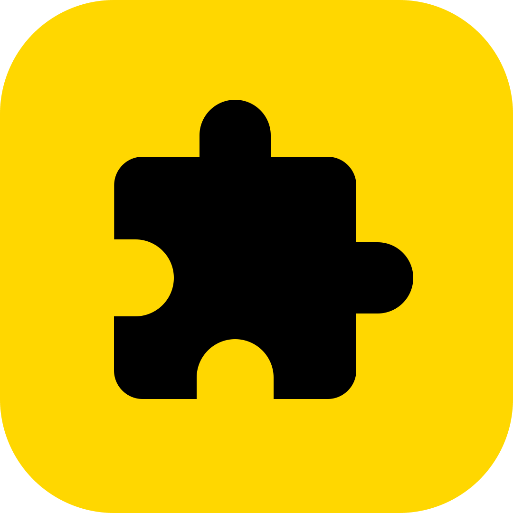

Shared configuration page components and C# helpers for Jellyfin plugins, delivered as the `JPKribs.Jellyfin.Base` NuGet package. The source and assets are compiled into each plugin at build time, so a plugin stays a single DLL with nothing extra to ship.

<br clear="left">

## Documentation

Usage, translations, every C# helper, every web component, and how a release works are covered in the **[Jellyfin Plugin Base documentation](https://jpkribs.github.io/jellyfin-plugin-base/)**.

## Package

```xml
<PackageReference Include="JPKribs.Jellyfin.Base" Version="12.4.0" />
```

## License

[GNU General Public License v3.0](LICENSE). A plugin built with Base is distributed under the same terms.

## Acknowledgements

The translations a plugin inherits come from [Jellyfin](https://jellyfin.org): the web client's strings from [jellyfin-web](https://github.com/jellyfin/jellyfin-web) and the server's from [jellyfin](https://github.com/jellyfin/jellyfin), written by Jellyfin's translators on [Weblate](https://translate.jellyfin.org). Base takes them from the Jellyfin release named in `jellyfin.json` and ships them under their own license, the GNU General Public License v2.0 or later, in the package's `jellyfin/LICENSE`.
